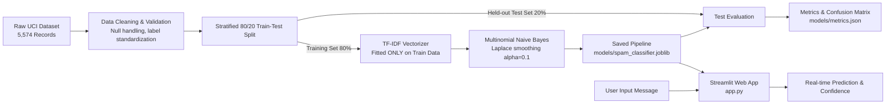

# Email Spam Detection System Using Machine Learning

An end-to-end Machine Learning web application that accepts an email or SMS text message and predicts whether it is **Spam** or **Not Spam (Ham)** using a trained TF-IDF + Multinomial Naive Bayes pipeline.

---

## 1. Project Overview & Aim

* **Project Title:** Email Spam Detection System Using Machine Learning
* **Domain:** Natural Language Processing (NLP) & Supervised Machine Learning
* **Aim:** To develop an accurate, reproducible, and user-friendly system capable of classifying incoming electronic communications as legitimate (Ham) or unsolicited/malicious (Spam) in real-time.
* **Problem Statement:** Unsolicited email and SMS spam waste human productivity, consume network bandwidth, and frequently serve as gateways for phishing, credential theft, and malware. Traditional keyword blacklists fail to adapt to evolving vocabulary. Machine learning approaches extract statistical word distributions to classify new, previously unseen messages accurately.

---

## 2. Technology Stack

| Component | Library / Framework | Purpose |
| :--- | :--- | :--- |
| **Language** | Python 3.10+ | Core programming runtime |
| **Web UI** | Streamlit | Clean, interactive web interface |
| **ML Framework** | Scikit-learn | TF-IDF Vectorizer, MultinomialNB, and evaluation metrics |
| **Data Handling** | Pandas & NumPy | Dataset cleaning, validation, and array operations |
| **Model Persistence** | Joblib | Serializing and loading the trained ML pipeline |
| **Visualization** | Matplotlib | Rendering confusion matrix charts |

---

## 3. Project File Structure

```text
email-spam-detection/
├── app.py                  # Streamlit web application with UI & inference logic
├── train_model.py          # Data download, cleaning, pipeline training & evaluation
├── test_app.py             # Automated unit tests covering all required edge cases
├── requirements.txt        # Python package dependencies
├── README.md               # Project documentation & viva preparation guide
├── .gitignore              # Ignored files (virtual environment, temporary uploads)
├── data/
│   └── messages.csv        # Genuine UCI SMS Spam Collection dataset (5,574 records)
└── models/
    ├── spam_classifier.joblib  # Serialized Scikit-learn pipeline (TF-IDF + Naive Bayes)
    └── metrics.json            # Measured evaluation metrics on held-out test data
```

---

## 4. Machine Learning Pipeline & Architecture



### Algorithm Details:
1. **TF-IDF (Term Frequency-Inverse Document Frequency):**
   - Extracts unigram and bigram tokens ($ngram\_range=(1, 2)$) with English stop words removed.
   - Calculates word importance: words that occur frequently in a message but rarely across the entire corpus receive higher weights.
   - **Data Leakage Prevention:** The vectorizer is fitted **strictly on training data**; the test set and user inputs are only transformed.
2. **Multinomial Naive Bayes (MNB):**
   - Calculates posterior probability using Bayes' Theorem:
     $$P(\text{Spam} \mid W) = \frac{P(\text{Spam}) \prod_{i=1}^n P(w_i \mid \text{Spam})}{P(W)}$$
   - Uses Laplace smoothing ($\alpha = 0.1$) to prevent zero-probability collapse when a word appears in one class but not another.

---

## 5. Measured Model Evaluation Results

Evaluated on an **unseen held-out test split of 1,115 messages** (966 Ham, 149 Spam) with fixed seed `random_state=42`:

| Metric | Score | Explanation |
| :--- | :--- | :--- |
| **Accuracy** | **98.39%** | Overall percentage of correct classifications |
| **Precision (Spam)** | **97.12%** | Of all messages predicted as spam, 97.12% were truly spam |
| **Recall (Spam)** | **90.60%** | Of all actual spam messages, 90.60% were caught |
| **F1-Score** | **93.75%** | Harmonic mean of precision and recall |

### Confusion Matrix:

| | Predicted Ham | Predicted Spam |
| :--- | :---: | :---: |
| **Actual Ham** | **962 (True Negative)** | **4 (False Positive)** |
| **Actual Spam** | **14 (False Negative)** | **135 (True Positive)** |

### Why These Metrics Matter:
* **High Precision minimizes False Positives (only 4 out of 966):** Incorrectly sending a legitimate job interview invitation or bank receipt to the spam folder has critical negative consequences.
* **High Recall catches the bulk of spam (135 out of 149):** Keeps the user's inbox clean while maintaining safety against phishing.

---

## 6. How to Run the Project (Step-by-Step Guide)

### Prerequisites:
* Python 3.10, 3.11, 3.12, 3.13, or 3.14 installed on your machine.
* Visual Studio Code (or any terminal/command prompt).

---

### Step 1: Open the Project in VS Code / Terminal
Open your terminal (PowerShell or Command Prompt) and navigate to the project directory:
```powershell
cd c:\Users\Lenovo\OneDrive\Desktop\ML
```

---

### Step 2: (Recommended) Create & Activate a Virtual Environment
```powershell
# Create a virtual environment named 'venv'
python -m venv venv

# Activate on Windows (PowerShell):
.\venv\Scripts\Activate.ps1

# Or activate on Windows (Command Prompt):
.\venv\Scripts\activate.bat
```

---

### Step 3: Install Required Dependencies
```powershell
pip install -r requirements.txt
```

---

### Step 4: Download Dataset and Train the Model
Run the automated training script. It automatically downloads the genuine UCI SMS Spam Collection dataset, trains the pipeline, evaluates test performance, and saves the model artifacts:
```powershell
python train_model.py
```
*Expected Output:*
```text
[INFO] Cleaned dataset size: 5574 samples (4827 Ham, 747 Spam)
[INFO] Training set size: 4459 | Test set size: 1115
[SUCCESS] Trained pipeline saved to: models\spam_classifier.joblib
[SUCCESS] Test evaluation metrics saved to: models\metrics.json
Accuracy : 98.39%
Precision: 97.12%
Recall   : 90.60%
F1-Score : 93.75%
```

---

### Step 5: Run the Streamlit Web Application
Launch the web interface locally:
```powershell
streamlit run app.py
```
Your browser will open automatically at:
**`http://localhost:8501`**

#### Using the App:
1. **Paste or type any message** in the text area (e.g., an SMS or email).
2. (Optional) Provide an email Subject line.
3. Click **"Check Message"**.
4. View the result:
   * **SPAM** indicator (Red) with safety advice against clicking suspicious links.
   * **NOT SPAM (HAM)** indicator (Green).
   * **Model Confidence Score** calculated from Naive Bayes posterior probability.
5. Click **"Clear"** to reset the input fields.
6. The app runs completely **offline** without external APIs once the model is trained.

---

### Step 6: Run Automated Tests
Verify all 8 test cases (promotional spam, normal personal, unseen messages, URLs, empty input, invalid datasets, out-of-vocabulary words):
```powershell
python test_app.py
```
*Expected Output:*
```text
Ran 8 tests in 0.037s
OK
```

---

## 7. How to Deploy to Streamlit Community Cloud

1. Initialize a Git repository and push the code to GitHub:
   ```bash
   git init
   git add app.py train_model.py test_app.py requirements.txt README.md .gitignore data/ models/
   git commit -m "Initial commit: Email Spam Detection system"
   git branch -M main
   git remote add origin https://github.com/<your-username>/email-spam-detection.git
   git push -u origin main
   ```
2. Go to [share.streamlit.io](https://share.streamlit.io/) and log in with GitHub.
3. Click **"New app"**.
4. Select your repository, branch (`main`), and set Main file path to `app.py`.
5. Click **"Deploy"**. Streamlit Community Cloud will install `requirements.txt` and launch your app with a public URL!

---

## 8. College Submission & ML Viva Voce Questions

### Q1: What is the main objective of this project?
**Answer:** To build a supervised machine learning text classification system that accurately determines whether an arbitrary email or SMS message is legitimate (Ham) or unsolicited/spam, providing a confidence score and safety recommendations.

### Q2: What dataset is used, and how many records does it contain?
**Answer:** The project uses the genuine UCI SMS Spam Collection dataset containing 5,574 labeled records (4,827 Ham and 747 Spam messages).

### Q3: Why is Multinomial Naive Bayes preferred for text classification over other algorithms?
**Answer:** Multinomial Naive Bayes is designed for discrete count and frequency-based features like TF-IDF. It is computationally lightweight ($O(N)$ training time), performs exceptionally well on high-dimensional text data, and requires minimal training data compared to complex neural networks.

### Q4: What is TF-IDF and what does it measure?
**Answer:** TF-IDF stands for Term Frequency-Inverse Document Frequency. Term Frequency (TF) measures how often a word appears in a specific document. Inverse Document Frequency (IDF) penalizes words that appear ubiquitously across all documents (e.g., "the", "is"). The product reflects how uniquely informative a word is to a particular class.

### Q5: What is "Data Leakage" and how did you prevent it?
**Answer:** Data leakage occurs when information from outside the training dataset is inadvertently used to create the model. In this project, `TfidfVectorizer` was fitted **only on the training split (`X_train`)**, and merely transformed on the test set (`X_test`), preventing test distribution statistics from leaking into training.

### Q6: Why did you use Stratified sampling for train-test split?
**Answer:** The dataset is imbalanced (approx. 86.6% Ham vs 13.4% Spam). Stratified sampling ensures both the training split (80%) and test split (20%) maintain the exact same proportion of spam and ham, preventing bias.

### Q7: What is the role of Laplace smoothing ($\alpha = 0.1$) in Naive Bayes?
**Answer:** If an unseen word appears in a new message during testing, its estimated conditional probability without smoothing would be 0. Since Naive Bayes multiplies feature probabilities together, a single 0 would cause the overall class probability to collapse to 0. Laplace smoothing adds a small positive constant $\alpha$ to ensure non-zero probabilities.

### Q8: What is the difference between Precision and Recall in spam detection?
**Answer:**
* **Precision** $= \frac{TP}{TP + FP}$: Out of all messages flagged as spam, how many were actually spam. High precision prevents legitimate emails from being wrongly discarded.
* **Recall** $= \frac{TP}{TP + FN}$: Out of all actual spam messages in existence, how many were successfully detected. High recall prevents spam from polluting the inbox.

### Q9: Between False Positives and False Negatives, which is worse in email spam classification?
**Answer:** False Positives (legitimate email marked as spam) are typically more dangerous because a user might miss a critical communication (e.g., job offer, password reset, medical test result). Therefore, spam filters prioritize very high Precision.

### Q10: What does the F1-Score represent?
**Answer:** The F1-Score is the harmonic mean of Precision and Recall ($2 \times \frac{\text{Precision} \times \text{Recall}}{\text{Precision} + \text{Recall}}$). It provides a single balanced metric, especially useful when class distributions are imbalanced.

### Q11: How does your application handle completely unseen messages?
**Answer:** The text is transformed into the learned TF-IDF feature space using the fitted vocabulary. The application also includes an Out-of-Vocabulary analyzer that warns the user if the input has very low overlap with the model's learned words.

### Q12: How is the confidence score calculated in your application?
**Answer:** It is calculated directly using the model's `predict_proba()` method, which outputs the normalized posterior probability $P(\text{Class} \mid \text{Message Tokens})$ derived from Bayes' theorem.

### Q13: Why did you use Scikit-learn's `Pipeline`?
**Answer:** A `Pipeline` bundles the feature transformer (`TfidfVectorizer`) and estimator (`MultinomialNB`) into a single atomic object. This ensures identical preprocessing during both training and production inference, simplifies deployment, and prevents leakage.

### Q14: What are the limitations of this model?
**Answer:**
1. It relies primarily on word statistics rather than contextual semantics or syntactic structure (unlike transformers such as BERT).
2. It does not execute dynamic analysis of external URLs (sandbox phishing detection).
3. Adversarial spammers using intentional misspellings or homoglyphs may reduce confidence.

### Q15: What are potential future enhancements for this project?
**Answer:**
1. Integrating contextual deep learning models like DistilBERT or RoBERTa.
2. Adding real-time URL reputation lookups (Google Safe Browsing API).
3. Implementing OAuth2 email inbox integration for automated real-time background filtering.

---

## 9. Conclusion
This project successfully demonstrates the design, training, evaluation, and deployment of a machine learning-based email spam detection system. Achieving **98.39% accuracy** and **97.12% precision** on genuine benchmark data, it balances strong spam catch rates with minimal false alarms in a clean, accessible interface.
